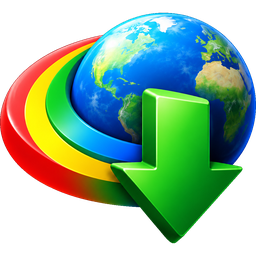
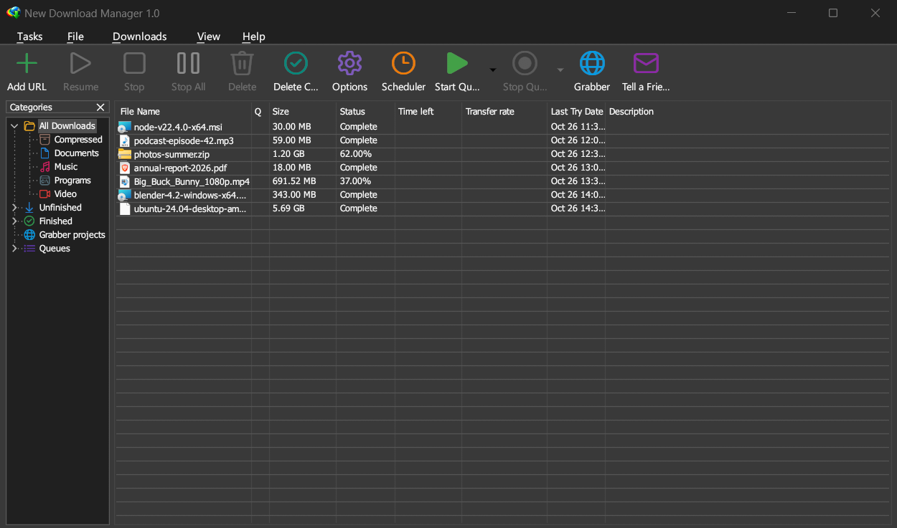
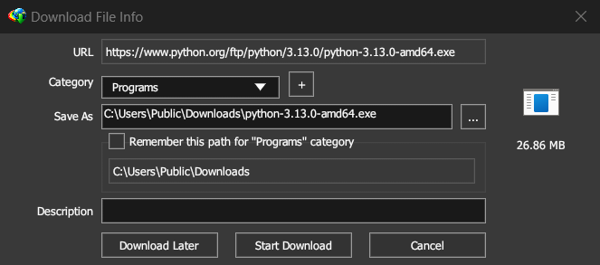
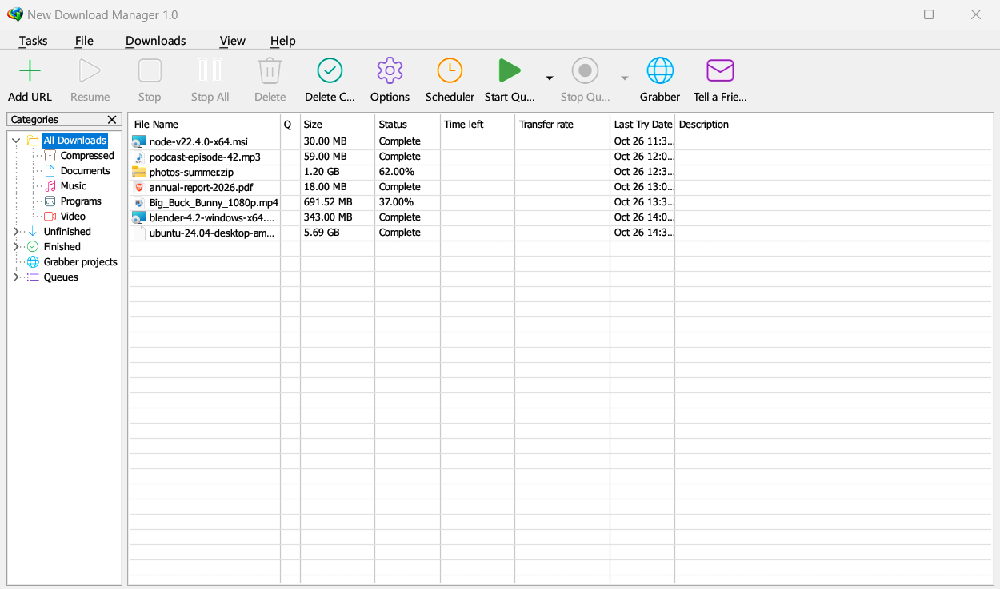
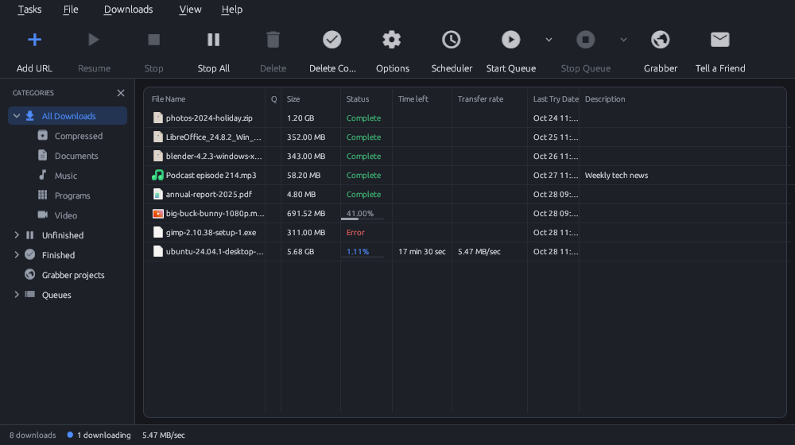
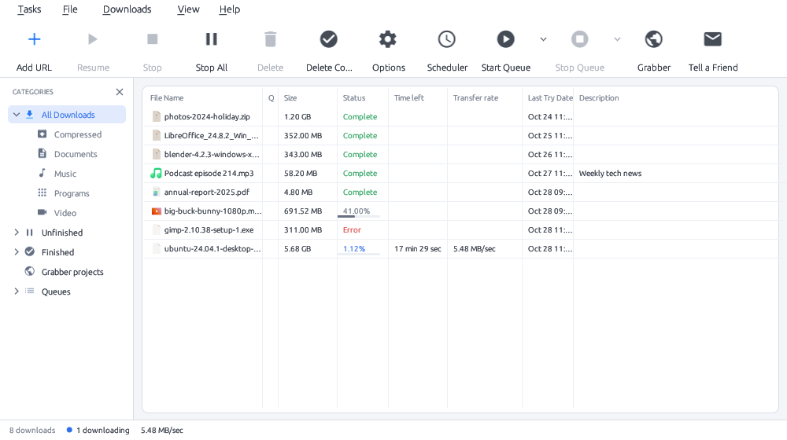

<p align="center">
  
</p>

<h1 align="center">New Download Manager</h1>

<p align="center">
  A fast, free and open source download manager for Windows, macOS and Linux, written in Rust.<br>
  Split downloads, browser integration, video streams, a site grabber and a scheduler, in one small native app.
</p>

<p align="center">
  <a href="https://github.com/MoeJoe37/New-Download-Manager/releases"><b>Download</b></a> ·
  <a href="#features">Features</a> ·
  <a href="#custom-toolbars">Custom toolbars</a> ·
  <a href="#custom-category-icons">Category icons</a> ·
  <a href="#building-from-source">Build</a> ·
  <a href="#translating">Translate</a> ·
  <a href="LICENSE">License (AGPL-3.0)</a>
</p>

<p align="center">
  
</p>

## Features

**Downloading**
- Splits every file into parts fetched over several connections at once; finished connections take over
  half of the slowest part, so they all stay busy to the end
- Opens a new connection every quarter second until the download runs at full speed, keeps connections
  open between parts and remembers the server's address, so parts start without a new handshake
- Notices a server that allows fewer connections (busy / too many requests) and keeps to what it allows
  instead of failing; can spread the connections over several networks at once (Wi-Fi, Ethernet, USB tethering)
- Resumes broken downloads, after checking that the file on the server hasn't changed
- http, https and ftp (passive and active); mms, rtmp and rtsp through ffmpeg
- Sign-in: Basic, Digest, NTLM / Negotiate (your Windows account, or your Kerberos ticket on Linux), saved site logins
- Proxies: Windows' settings, auto-configuration scripts, HTTP, HTTPS, FTP and SOCKS 4/5
- Speed limiter, download limits per period, per-server connection limits

**Browser integration**
- Extension for Chrome, Edge, Brave, Opera, Vivaldi and Firefox: downloads go to NDM, not the browser,
  and NDM starts in the notification area if it isn't running
- Right-click *Download with New Download Manager* and *Download all links*
- Download panel on video and audio players
- Keys to force or prevent a download, file-type and site exceptions
- Optional system-wide capture of plain http downloads from any program

**Video and audio streams**
- HLS (.m3u8) and DASH (.mpd), including AES-128, byte ranges, multi-period and live streams
- Video and audio joined into one MP4 or WebM without any extra program

**Organizing**
- Categories with their own folders, queues with a scheduler (start / stop times, days, retries)
- Synchronization queue that re-downloads files changed on the server
- When a queue is done: open a file, hang up, exit, shut down, sleep or hibernate

**Site Grabber**
- Explores a site from a start page and downloads the files you pick: all pictures, every PDF,
  or a whole site converted for offline browsing
- Saved projects, templates and schedules

**And**
- Dark mode and three looks: Modern, Classic and **NDM Style**, NDM's own modern design for every window
- Custom scale for the toolbar, the categories pane and the text (View → Custom scale...)
- Customizable toolbar and columns, [custom toolbars](#custom-toolbars) and [custom category icons](#custom-category-icons) with your own pictures
- Clipboard monitor, drop target, command line (`/d URL /p folder /f name /n /a /q /s`)
- Import and export of download lists, built-in help, automatic update check
- English, Spanish, French and Arabic (right to left: every window is mirrored), and any language you add
  (View → Language, see [Translating](#translating))
- Starts on any machine: when the graphics driver's OpenGL doesn't work (virtual machines, remote desktops,
  old drivers) NDM starts again with Direct3D / Vulkan / Metal or Windows' software renderer, and when another
  program holds its browser port it takes the next one (the extension finds it)

<p align="center">
  <br>
  <sub>A download handed over by the browser</sub>
</p>

<p align="center">
  <br>
  <sub>Light mode</sub>
</p>

<p align="center">
  <br>
  <sub>NDM Style (View → Toolbar → NDM Style), dark mode</sub>
</p>

<p align="center">
  <br>
  <sub>NDM Style, light mode</sub>
</p>

## Installing

Every file is on the [Releases](https://github.com/MoeJoe37/New-Download-Manager/releases) page:

| System | File |
|---|---|
| Windows 10/11, x64 | `NDM-Setup-<version>.exe`, or `NDM-<version>-windows-x64.zip` (portable) |
| Windows 11 on ARM (Snapdragon) | `NDM-ARM64-Setup-<version>.exe`, or `NDM-<version>-windows-arm64.zip` |
| macOS 11 or later (Apple Silicon and Intel) | `NDM-<version>-macOS.dmg` |
| Linux x86_64 | `ndm_<version>_amd64.deb`, `ndm-<version>-1.x86_64.rpm`, `NDM-x86_64.AppImage`, `ndm-<version>-x86_64.tar.gz` |
| Linux aarch64 (Raspberry Pi 4/5, ARM laptops and servers) | `ndm_<version>_arm64.deb`, `ndm-<version>-1.aarch64.rpm`, `NDM-aarch64.AppImage`, `ndm-<version>-aarch64.tar.gz` |

**Windows:**

1. Download the setup for your processor and run it. It installs for your user only (no admin rights
   needed). The portable zip runs from any folder (a USB stick, too): unpack it and start `ndm.exe`.
2. Install the browser extension: open your browser's extensions page, turn on *Developer mode*, click
   *Load unpacked* and choose the `extension` folder in NDM's install folder
   (Start menu → New Download Manager → *Browser extension folder*).
3. Start NDM once, so the browser can reach it.

**macOS:** open the `.dmg` and drag *NDM* onto *Applications*. NDM isn't notarized by Apple, so the first
time, right-click (or Control-click) NDM in Applications and choose **Open**, then **Open** again; after that
it starts normally. (Or run `xattr -dr com.apple.quarantine /Applications/NDM.app` once in Terminal.) Its
icon sits in the menu bar while it runs. Load the browser extension from
`~/Library/Application Support/NewDownloadManager/extension`, the copy NDM keeps there so updates don't move
it (*Options → General → Reintegrate All* shows the steps for each browser).

**Linux:** download the package for your distribution and processor: `.deb` (Debian, Ubuntu, Mint, Raspberry
Pi OS), `.rpm` (Fedora, RHEL, openSUSE), the AppImage (any distribution: make it executable with
`chmod +x NDM-x86_64.AppImage` and run it) or the `.tar.gz` (unpack and run `./ndm`). Everything the Windows version has works there too: the tray icon (on desktops with a tray: KDE, Xfce,
Cinnamon, MATE, GNOME with the AppIndicator extension), the drop target, dial-up / VPN through NetworkManager,
the desktop's proxy, PAC scripts, NTLM and Kerberos sign-in, links dropped on the main window and Firefox's cache.

NDM checks the Releases page for new versions (Help → Check for updates, and by itself every two weeks).

## Custom toolbars

A custom toolbar replaces the pictures on NDM's toolbar buttons with your own. It is a folder of PNG files, one
per button; NDM lists every such folder under **View → Toolbar** (also on the toolbar's right-click menu).

**1. Find the toolbars folder.** Choose **View → Toolbar → Open toolbars folder**. NDM creates and opens it:

| System | Folder |
|---|---|
| Windows | `%APPDATA%\NewDownloadManager\toolbars` |
| Linux | `~/.config/NewDownloadManager/toolbars` (or `$XDG_CONFIG_HOME/NewDownloadManager/toolbars`) |
| macOS | `~/Library/Application Support/NewDownloadManager/toolbars` |

**2. Make a folder for your toolbar** inside it. The folder's name is the toolbar's name in the menu, for example
`toolbars/Sunset`.

**3. Add one PNG per button**, named after the button:

| Button | File |
|---|---|
| Add URL | `add-url.png` |
| Resume | `resume.png` |
| Stop | `stop.png` |
| Stop All | `stop-all.png` |
| Delete | `delete.png` |
| Delete Completed | `delete-completed.png` |
| Options | `options.png` |
| Scheduler | `scheduler.png` |
| Start Queue | `start-queue.png` |
| Stop Queue | `stop-queue.png` |
| Grabber | `grabber.png` |
| Tell a Friend | `tell-a-friend.png` |

Optional, for each button:

- `<button>-hot.png`: shown while the mouse is over the button (otherwise NDM lightens the normal picture)
- `<button>-disabled.png`: shown while the button can't be used (otherwise NDM greys the normal picture)
- `small/<button>.png` (and `small/<button>-hot.png`, `small/<button>-disabled.png`): drawn for
  **Small Buttons** instead of the large picture made smaller

Pictures should be square-ish with a transparent background. NDM fits each one into the button, keeping its
proportions: large buttons are 56 × 42 pixels and small ones 32 × 32 at 100% scale, so draw them at least 112 × 84
(or 96 × 96) to stay sharp at higher **View → Custom scale** sizes. A button without a picture keeps NDM's own icon,
so a toolbar can change just a few buttons.

```
toolbars/
└── Sunset/
    ├── add-url.png
    ├── add-url-hot.png
    ├── resume.png
    ├── stop.png
    ├── options.png
    └── small/
        └── add-url.png
```

**4. Choose it:** **View → Toolbar → Sunset**. **Built-in toolbar** goes back to NDM's own icons. After changing
the pictures, choose another toolbar and then yours again to reload them.

To share a toolbar, zip its folder; whoever gets it unzips it into their toolbars folder. You can post toolbars
for others in [Issues](https://github.com/MoeJoe37/New-Download-Manager/issues).

**Help → Look for new toolbars** opens this guide.

## Custom category icons

A category icon set replaces the pictures in the categories pane (All Downloads, Unfinished, Finished, the
categories, Grabber projects and Queues) with your own. Like a toolbar, it is a folder of PNG files; NDM lists
every such folder under **View → Category icons**. It works in all three styles (Modern, Classic and NDM Style).

**1. Find the category icons folder.** Choose **View → Category icons → Open category icons folder**. NDM creates
and opens it:

| System | Folder |
|---|---|
| Windows | `%APPDATA%\NewDownloadManager\category-icons` |
| Linux | `~/.config/NewDownloadManager/category-icons` (or `$XDG_CONFIG_HOME/NewDownloadManager/category-icons`) |
| macOS | `~/Library/Application Support/NewDownloadManager/category-icons` |

**2. Make a folder for your set** inside it. The folder's name is the set's name in the menu, for example
`category-icons/Candy`.

**3. Add one PNG per item**, named after it:

| Item | File |
|---|---|
| All Downloads | `all-downloads.png` |
| Unfinished | `unfinished.png` |
| Finished | `finished.png` |
| Compressed | `compressed.png` |
| Documents | `documents.png` |
| Music | `music.png` |
| Programs | `programs.png` |
| Video | `video.png` |
| General | `general.png` |
| Any other category | its name in lower case, spaces as `-` (a category "Mobile Apps" is `mobile-apps.png`) |
| Every category without its own file | `category.png` |
| Grabber projects | `grabber-projects.png` |
| A grabber project | `grabber-project.png` (otherwise `grabber-projects.png`) |
| Queues | `queues.png` |
| A queue | `queue.png` |
| A queue that is running | `queue-running.png` (otherwise `queue.png`) |

Pictures should be square with a transparent background, 64 × 64 pixels or larger so they stay sharp at higher
**View → Custom scale** sizes; NDM fits each one into the row. An item without a picture keeps NDM's own icon, so a
set can change just a few.

```
category-icons/
└── Candy/
    ├── all-downloads.png
    ├── finished.png
    ├── video.png
    ├── category.png
    └── queue-running.png
```

**4. Choose it:** **View → Category icons → Candy**. **Built-in icons** goes back to NDM's own. Choosing a set again
reloads its pictures after you change them.

To share a set, zip its folder; whoever gets it unzips it into their category icons folder. You can post sets for
others in [Issues](https://github.com/MoeJoe37/New-Download-Manager/issues). **Help → Look for new category icons**
opens this guide.

## Building from source

Requirements: Windows 10/11 (x64 or ARM64), [Rust](https://rustup.rs) (stable, MSVC toolchain), the Windows
SDK (for the exe icon).

```sh
cargo build --release          # target\release\ndm.exe
cargo test --release           # tests
```

Installer ([Inno Setup 6](https://jrsoftware.org/isinfo.php)); `/DArch=arm64` makes the ARM64 one from
`target\aarch64-pc-windows-msvc\release\ndm.exe`:

```sh
"C:\Program Files (x86)\Inno Setup 6\ISCC.exe" installer\ndm.iss   # installer\out\NDM-Setup-<version>.exe
```

| Folder | What |
|---|---|
| `src/` | The app (egui UI, download engine, streams, grabber) |
| `extension/` | Browser extension (Manifest V3) |
| `help/` | Help pages, shown inside the app |
| `Languages/` | Language files |
| `installer/` | Inno Setup script |
| `tools/` | `ndm_lng.py` (language file generator), `icon.py` (app icon), `appimage.sh`, `linux-packages.sh` and `macos.sh` (packages), `smoke*` (start-up tests CI runs) |

Linux packages (on Linux, x86_64 or aarch64, or in WSL on Windows; needs `build-essential pkg-config
libgtk-3-dev libxdo-dev libayatana-appindicator3-dev`, `rpm` for the .rpm, and Rust):

```sh
bash tools/appimage.sh                                  # installer/out/NDM-<arch>.AppImage
bash tools/linux-packages.sh target/release/ndm         # .deb, .rpm and .tar.gz
```

macOS (Xcode command line tools and Rust with both Mac targets:
`rustup target add aarch64-apple-darwin x86_64-apple-darwin`):

```sh
bash tools/macos.sh            # installer/out/NDM-<version>-macOS.dmg, one app for Apple Silicon and Intel
```

GitHub Actions builds and tests all of them (`.github/workflows/ci.yml`) and attaches them to a release when
a `v<version>` tag is pushed (`release.yml`).

## Translating

`Languages/ndm_en.lng` lists every text NDM shows, one `English=Text` per line. It is generated from the
source by `python tools/ndm_lng.py` (`--check` tells whether it is up to date, and whether every translation
keeps its placeholders).

NDM comes with Spanish (`ndm_es.lng`), French (`ndm_fr.lng`) and Arabic (`ndm_ar.lng`). To add a language,
copy `ndm_en.lng` to `ndm_xx.lng`, change the first line (`lang=0x407 Deutsch`), and translate the text after
each `=`. Keep `%s` / `%d` and `\n`, in the same order. A string you leave out shows in English, and a text
too long for its place is drawn smaller. The `%b %d %H:%M:%S %Y` line is the date format (`%d/%m/%Y` for
day/month/year). NDM lists the file under **View → Language**.

Files named `ndm_ar`, `ndm_fa`, `ndm_he` or `ndm_iw` are right to left: NDM mirrors every window and lays the
text out itself (letters joined, words in reading order), so the translation is written as usual.
Pull requests welcome.

## License

[GNU Affero General Public License v3.0](LICENSE). The toolbar and tree icons are drawn at run time from
Windows' own icon font (Segoe Fluent Icons); on Linux from Google's Material Icons
(`assets/linux`, Apache License 2.0).
