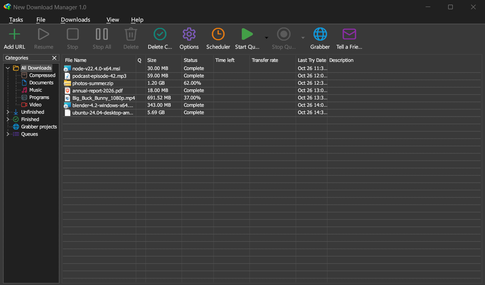
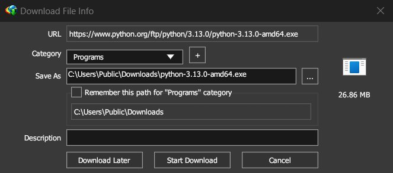
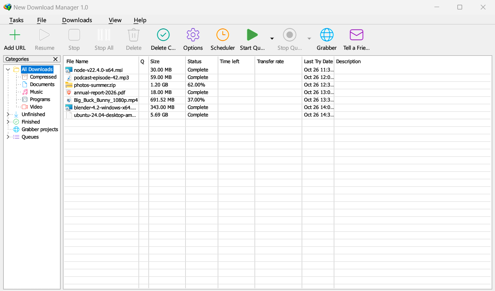

<p align="center">
  
</p>

<h1 align="center">New Download Manager</h1>

<p align="center">
  A fast, free and open source download manager for Windows and Linux, written in Rust.<br>
  Split downloads, browser integration, video streams, a site grabber and a scheduler, in one small native app.
</p>

<p align="center">
  <a href="https://github.com/MoeJoe37/New-Download-Manager/releases"><b>Download</b></a> ·
  <a href="#features">Features</a> ·
  <a href="#building-from-source">Build</a> ·
  <a href="#translating">Translate</a> ·
  <a href="LICENSE">License (AGPL-3.0)</a>
</p>

<p align="center">
  
</p>

## Features

**Downloading**
- Splits every file into parts fetched over several connections at once; finished connections take over
  half of the slowest part, so they all stay busy to the end
- Resumes broken downloads, after checking that the file on the server hasn't changed
- http, https and ftp (passive and active); mms, rtmp and rtsp through ffmpeg
- Sign-in: Basic, Digest, NTLM / Negotiate (your Windows account), saved site logins
- Proxies: Windows' settings, auto-configuration scripts, HTTP, HTTPS, FTP and SOCKS 4/5
- Speed limiter, download limits per period, per-server connection limits

**Browser integration**
- Extension for Chrome, Edge, Brave, Opera, Vivaldi and Firefox: downloads go to NDM, not the browser,
  and NDM starts in the notification area if it isn't running
- Right-click *Download with New Download Manager* and *Download all links*
- Download panel on video and audio players
- Keys to force or prevent a download, file-type and site exceptions
- Optional system-wide capture of plain http downloads from any program

**Video and audio streams**
- HLS (.m3u8) and DASH (.mpd), including AES-128, byte ranges, multi-period and live streams
- Video and audio joined into one MP4 or WebM without any extra program

**Organizing**
- Categories with their own folders, queues with a scheduler (start / stop times, days, retries)
- Synchronization queue that re-downloads files changed on the server
- When a queue is done: open a file, hang up, exit, shut down, sleep or hibernate

**Site Grabber**
- Explores a site from a start page and downloads the files you pick: all pictures, every PDF,
  or a whole site converted for offline browsing
- Saved projects, templates and schedules

**And**
- Dark mode, two looks (Modern / Classic), customizable toolbar and columns
- Clipboard monitor, drop target, command line (`/d URL /p folder /f name /n /a /q /s`)
- Import and export of download lists, built-in help, automatic update check

<p align="center">
  <br>
  <sub>A download handed over by the browser</sub>
</p>

<p align="center">
  <br>
  <sub>Light mode</sub>
</p>

## Installing

1. Download `NDM-Setup-<version>.exe` from [Releases](https://github.com/MoeJoe37/New-Download-Manager/releases)
   and run it. It installs for your user only (no admin rights needed).
2. Install the browser extension: open your browser's extensions page, turn on *Developer mode*, click
   *Load unpacked* and choose the `extension` folder in NDM's install folder
   (Start menu → New Download Manager → *Browser extension folder*).
3. Start NDM once, so the browser can reach it.

**Linux:** download `NDM-x86_64.AppImage` from Releases, make it executable (`chmod +x NDM-x86_64.AppImage`)
and run it. On Linux NDM has no tray icon yet (closing the window quits) and no dial-up support.

NDM checks the Releases page for new versions (Help → Check for updates, and by itself every two weeks).

## Building from source

Requirements: Windows 10/11 x64, [Rust](https://rustup.rs) (stable, MSVC toolchain), the Windows SDK
(for the exe icon).

```sh
cargo build --release          # target\release\ndm.exe
cargo test --release           # tests
```

Installer ([Inno Setup 6](https://jrsoftware.org/isinfo.php)):

```sh
"C:\Program Files (x86)\Inno Setup 6\ISCC.exe" installer\ndm.iss   # installer\out\NDM-Setup-1.0.0.exe
```

| Folder | What |
|---|---|
| `src/` | The app (egui UI, download engine, streams, grabber) |
| `extension/` | Browser extension (Manifest V3) |
| `help/` | Help pages, shown inside the app |
| `Languages/` | Language files |
| `installer/` | Inno Setup script |
| `tools/` | `ndm_lng.py` (language file generator), `icon.py` (app icon), `appimage.sh` (Linux AppImage) |

Linux AppImage (on Linux, or in WSL on Windows; needs `build-essential pkg-config libgtk-3-dev libxdo-dev
libayatana-appindicator3-dev` and Rust):

```sh
bash tools/appimage.sh         # installer/out/NDM-x86_64.AppImage
```

## Translating

`Languages/ndm_en.lng` lists every text NDM shows, one `English=Text` per line. It is generated from the
source by `python tools/ndm_lng.py` (`--check` tells whether it is up to date).

To add a language, copy it to `ndm_xx.lng`, change the first line (`lang=0x407 Deutsch`), and translate the
text after each `=`. Keep `%s` / `%d` and `\n`. NDM lists the file under **View → Language**.
Pull requests welcome.

## License

[GNU Affero General Public License v3.0](LICENSE). The toolbar and tree icons are drawn at run time from
Windows' own icon font (Segoe Fluent Icons); on Linux from Google's Material Icons
(`assets/linux`, Apache License 2.0).
